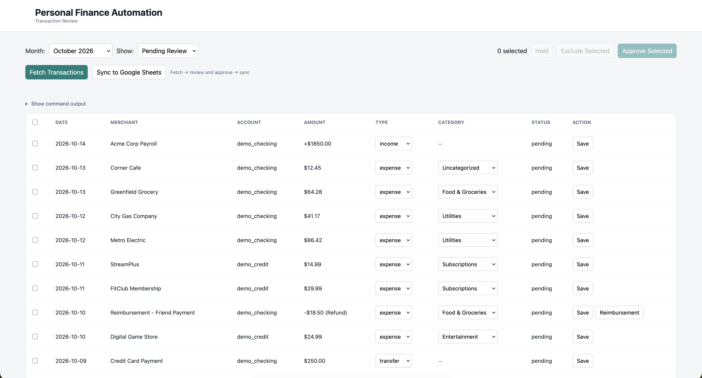
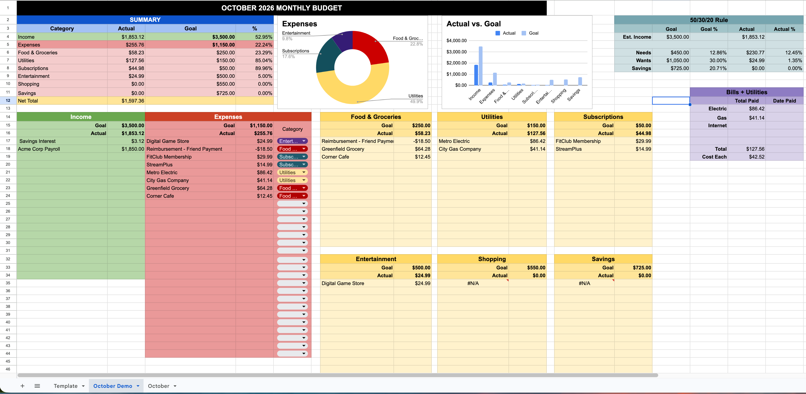

# personal-finance-automation
### Personal Finance Automation Tool

This is a python based tool that automatically retrieves bank transactions from multiple accounts connected through plaid. It'll categorize recurring/expected expenses, and push reviewed transactions to a google sheets budgeting page. I put together this project to automate my existing budgeting workflow, without replacing the spreadsheet I already use. Rather than manually entering transactions from multiple accounts each week, the application consolidates them into a single review interface, where I can categorize spending, approve transactions, and update my budget

<h2>Demo</h2>

<table>
  <tr>
    <td width="50%" align="center">
      
      <br>
      <b>Transaction Review Interface</b>
    </td>
    <td width="50%" align="center">
      
      <br>
      <b>Automated Google Sheets Budget</b>
    </td>
  </tr>
</table>

## Features

- **Multi-account integration:** Uses plaid free trial to connect up to 10 financial accounts
- **Incremental transaction syncing:** Retrieves new and updated transactions without repeatedly importing the same records
- **Automatic categorization:** Recognizes predictable expenses such as groceries, utility bills, and recurring subscriptions
- **Transaction Review:** Ability to manually categorize purchases, classify income, and approve or exclude transactions before exporting
- **Reimbursement Handling:** Record repayments as negative expenses to accurately reflect net spending
- **Transfer Detection:** Identify credit card payments and transfers between accounts to avoid double-counting
- **Google Sheets Integration:** Automatically populate income and expense tables in an existing spreadsheet, preserving its formulas, formatting, and charts
- **Conflict Prevention:** Flag bank-side changes to reviewed transactions without overwriting previous decisions
- **Duplicate Prevention:** Track exported transactions using unique identifiers
- **Credential Storage:** Encrypt Plaid access tokens and separate development and production data

## USES

| Component | Technology |
|---|---|
| Frontend | HTML, CSS, JavaScript |
| Backend | Python, FastAPI |
| Bank Integration | Plaid API |
| Database | SQLite |
| Spreadsheet Integration | Google Sheets API |
| Authentication | Google OAuth 2.0 |
| Token Encryption | Fernet (cryptography) |

## How it Works

**Plaid API → SQLite → Transaction Review → Google Sheets**

### 1. Fetch Transactions

Plaid retrieves available transactions from connected financial institutions. Transactions are normalized and stored in SQLite. New transactions are assigned an initial type and category when the available information is sufficiently reliable

### 2. Categorize and Review

A local web interface displays transactions for a selected month. Here you can edit transaction types and expense categories, approve transactions for export, exclude transfers and irrelevant transactions, record reimbursements as negative expenses, and review conflicts caused by subsequent bank-side changes

### 3. Sync to Google Sheets

Approved transactions are exported to the appropriate monthly tab in an existing Google Sheets budget. Income is written to a dedicated income table, while expenses are written with their descriptions, amounts, and categories. (Each exported transaction is associated with a unique tracking identifier to prevent duplicate entries during subsequent syncs)

## Installation

**Requires:**

- Python 3.13+
- Plaid developer account (allows connection to up to 10 banks)
- Google Cloud project with Google Sheets API enabled
- Google OAuth credentials
- Existing Google Sheets budget with configured input ranges

**1. Clone the repo**

**2. Create and activate a virtual environment**

**3. Install dependencies (with requirements.txt)**

**4. Create a .env file in the project root containing:**

```dotenv
PLAID_ENV=sandbox
PLAID_CLIENT_ID=your_plaid_client_id
PLAID_SECRET=your_plaid_secret
FINANCE_ENCRYPTION_KEY=your_fernet_encryption_key
GOOGLE_SPREADSHEET_ID=your_spreadsheet_id
```

**5. Generate a Fernet encryption key:**

```bash
python -c "from cryptography.fernet import Fernet; print(Fernet.generate_key().decode())"
```

**6. Place your Google OAuth desktop application credentials in credentials.json in the project root**

## Running the Application

**1. Initialize the database:**

```bash
python -c "from app.database import initialize_database; initialize_database()"
```

**2. Start the local server:**

```bash
python -m uvicorn app.main:app --reload --host 127.0.0.1
```

**3. Open Interfaces:**

- Bank connections: http://127.0.0.1:8000/connect
- Transaction review: http://127.0.0.1:8000/review

**NOTE:** The application is intended for local use and does not currently implement user authentication. Do not expose the server publicly.

## Disclaimer

This is a personal project intended for local use and experimentation. It is not a commercial financial product or financial advisory service.
